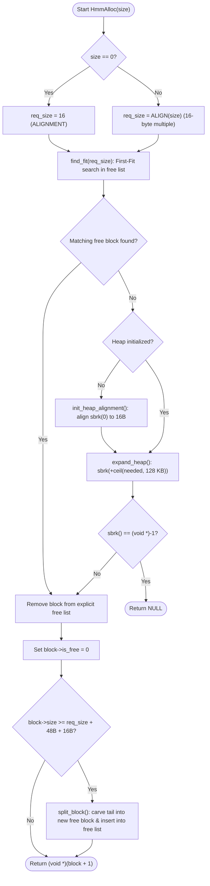
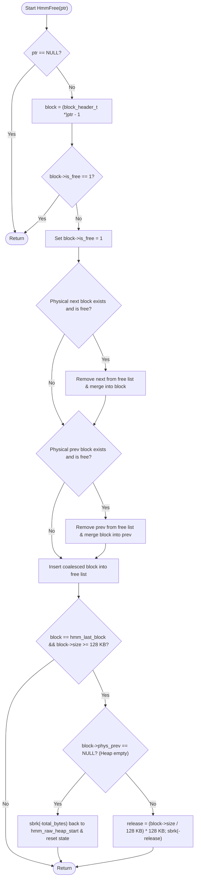

# Heap Memory Manager (HMM)

A custom user-space dynamic memory allocator written in C that provides drop-in replacements for the C standard library `malloc`, `free`, `calloc`, and `realloc` functions. It manages heap memory directly on Linux/POSIX via the `sbrk()` system call and supports both static linking and runtime interposition via `LD_PRELOAD`[cite: 11, 12, 13].

---

## Detailed Design

### 1. Block Metadata Header & 16-Byte Alignment
Every allocated or free memory region is preceded by a hidden **48-byte `block_header_t`** ($3 \times 16\text{ bytes}$):

```text
+-----------------------------------+-----------------------------------+
|      block_header_t (48 bytes)    |    User Payload (16B-aligned)     |
+-----------------------------------+-----------------------------------+
^                                   ^
block (internal metadata pointer)   ptr returned to caller = (block + 1)
```

```c
typedef struct block_header {
    size_t size;                    /* Payload size in bytes (excluding 48B header) */
    size_t is_free;                 /* 1 = free, 0 = allocated */
    struct block_header *prev;      /* Previous node in explicit free list */
    struct block_header *next;      /* Next node in explicit free list */
    struct block_header *phys_prev; /* Physically adjacent lower block in RAM */
    size_t _pad;                    /* 8-byte spacer to pad header to 48 bytes */
} block_header_t;
```

* **Alignment Guarantee:** On the first allocation, `init_heap_alignment()` queries `sbrk(0)` and advances the program break by `0..15` bytes so `hmm_heap_start` begins on a 16-byte boundary. All requested sizes are rounded up to a multiple of 16 bytes (`ALIGN(size)`), ensuring every header and user payload pointer `(void *)(block + 1)` is 16-byte aligned for x86_64 SIMD/ABI compatibility.

### 2. Explicit Doubly-Linked Free List & First-Fit Splitting
* **Explicit Free List:** Free blocks are linked together via `prev` and `next` pointers (`hmm_free_list_head`), enabling $O(1)$ insertion/removal and allowing `find_fit()` to skip allocated blocks.
* **First-Fit & Splitting:** `HmmAlloc()` selects the first free block where `block->size >= req_size`. If the block has at least `sizeof(block_header_t) + 16` bytes left over, `split_block()` carves the remainder into a new free block and inserts it into the free list.

### 3. Bidirectional Coalescing
* When `HmmFree(ptr)` is called, it checks both physically adjacent neighbors in $O(1)$ time:
  * **Forward neighbor:** Located at `(char *)(block + 1) + block->size`.
  * **Backward neighbor:** Located via `block->phys_prev`.
* If either neighbor is free, it is unlinked from the free list and merged into a single contiguous free block to prevent external fragmentation.

### 4. Minimizing `sbrk()` System-Call Overhead
* **Batched Expansion (`128 KB`):** Whenever no free block satisfies a request, `expand_heap()` grows the program break in multiples of **`SBRK_CHUNK_SIZE` (`128 KB`)** rather than calling `sbrk()` per allocation[cite: 6, 7]. If the top-most block (`hmm_last_block`) is already free, it is extended in place without creating a duplicate header.
* **Batched Contraction (`128 KB`):** When `HmmFree()` produces a free block at the top of the heap (`hmm_last_block`) of at least **`SHRINK_THRESHOLD` (`128 KB`)**, it releases whole `128 KB` chunks back to the OS via negative `sbrk(-release_bytes)`—or restores `sbrk(0)` completely back to `hmm_raw_heap_start` when the entire heap becomes empty.
* **Syscall Validation:** Every `sbrk()` return value is checked against `(void *)-1`, and `HmmFree()` guards against `NULL` pointers and double-frees.

---

## Flowcharts

### `HmmAlloc(size_t size)`



### `HmmFree(void *ptr)`



---

## Project Structure

* `inc/Hmm.h` — Public declarations for `HmmAlloc`, `HmmFree`, `hmmCalloc`, `hmmReAlloc`, and `hmmSize`[cite: 11].
* `inc/hmm_internal.h` — Private `block_header_t` layout, alignment macros, and free-list helpers.
* `src/HmmAlloc.c` — `HmmAlloc()`, alignment initialization, First-Fit search, block splitting, and batched `sbrk()` expansion.
* `src/HmmFree.c` — `HmmFree()`, bidirectional coalescing, and negative `sbrk()` contraction.
* `src/HmmEx.c` — `hmmSize()`, `hmmCalloc()` (with overflow protection), and in-place/copy `hmmReAlloc()`.
* `src/heapWrappers.c` — Standard `malloc`, `free`, `calloc`, and `realloc` wrappers redirecting to the `Hmm*` implementation[cite: 11].
* `test/main.c` — Unit test suite verifying alignment, coalescing, program break restoration, `realloc`, and `calloc`.
* `tlpi/free_and_sbrk.c` — TLPI benchmark suite testing program break growth and contraction under `LD_PRELOAD`[cite: 6, 7].

---

## Requirements

The project targets Linux because the allocator uses POSIX/Linux interfaces such as `sbrk()`[cite: 11].

Install the required build tools on Debian or Ubuntu[cite: 11]:

```sh
sudo apt update
sudo apt install build-essential
```

---

## Build

From the repository root, build the static library and unit test executable[cite: 11]:

```sh
make
```

Build individual outputs[cite: 11]:

```sh
make static_lib
make shared_lib
make test
make tlpi_test
```

The generated files are[cite: 11]:
* `build/lib/libhmm.a`: static library[cite: 11]
* `build/lib/libhmm.so`: shared library for Linux runtime interposition[cite: 11]
* `build/hmm_test`: allocator unit test executable[cite: 11]
* `build/free_and_sbrk`: TLPI `free_and_sbrk` benchmark executable

Remove generated files with[cite: 11]:

```sh
make clean
```

---

## Run the Tests

### 1. Unit Test Suite
Build and run the unit test executable[cite: 12]:

```sh
make test
./build/hmm_test
```

For additional compiler diagnostics and sanitizers, override `CFLAGS` when building[cite: 12]:

```sh
make clean
make CFLAGS="-Wall -Wextra -Wpedantic -g -fPIC -fsanitize=address,undefined"
./build/hmm_test
```

### 2. TLPI `free_and_sbrk` Benchmark
Build and execute the official TLPI `free_and_sbrk` benchmark preloaded with `libhmm.so`:

```sh
make tlpi_test
```

This runs three cases:
* `free_and_sbrk 1000 10240 2 1 1000` — Frees alternating blocks; block #1000 remains allocated at the top of the heap, keeping the program break elevated.
* `free_and_sbrk 1000 10240 1 1 999` — Frees blocks 1–999; block #1000 pins the top of the heap, keeping the program break elevated.
* `free_and_sbrk 1000 10240 1 500 1000` — Frees trailing blocks 500–1000; trailing blocks coalesce and contract the program break via negative `sbrk()`.

---

## Link an Application Statically

Build the static library, then place the library after the application's source or object files in the compiler command[cite: 12]:

```sh
make static_lib
gcc -Iinc example.c build/lib/libhmm.a -o example
./example
```

The linked executable uses the wrappers from this project for its standard allocation calls[cite: 12].

---

## Use the Allocator in a Linux Shell (`LD_PRELOAD`)

Linux can load `libhmm.so` before `libc` by using `LD_PRELOAD`, redirecting allocation calls made by dynamically linked programs to this library[cite: 12].

Build the shared library and save its absolute path[cite: 12]:

```sh
make shared_lib
export HMM_LIB="$(pwd)/build/lib/libhmm.so"
```

Use the allocator for one command[cite: 13]:

```sh
LD_PRELOAD="$HMM_LIB" ls -la
```

To use the allocator for a temporary child shell and dynamically linked commands launched from it[cite: 13]:

```sh
LD_PRELOAD="$HMM_LIB" bash --noprofile --norc
```

Inside that child shell, confirm the setting and run commands normally[cite: 13]:

```sh
printf '%s\n' "$LD_PRELOAD"
ls
grep --version
```

Leave the temporary shell with `exit`, or disable interposition in the current shell with `unset LD_PRELOAD`[cite: 13]. Do not add this library to `/etc/ld.so.preload`[cite: 13].
